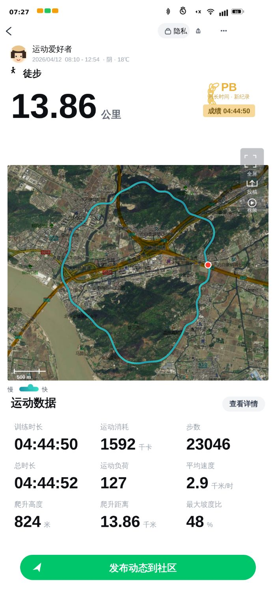

# 运动轨迹卡片生成器

一个单文件 HTML 工具，用来生成 Keep 风格的健身 / 徒步分享卡片：真实卫星底图 + 程序生成的 GPS 轨迹 + 一套自洽的运动数据，一键导出 PNG。

打开 `index.html` 就能用，无需构建、无需服务器、无外部依赖（底图瓦片联网加载）。



## 它做什么

左侧是控制面板，右侧实时预览。

- **地点**：输入经纬度，或直接搜地名（如「温州」）定位
- **目标距离 / 目标时长**：轨迹与实际运动数据都按这两个目标反解
- **种子**：同一个种子完全复现轨迹与数据，方便反复出图
- **轨迹形状**：环线 / 往返 / 单程
- **爬升强度**：0–100，同时改变高程幅度与配速分布
- **底图**：Google 卫星 / 高德卫星 / 高德卫星+注记
- **账号与文案**：昵称、日期、开始时间、天气、气温、PB 徽章、底部行动条、水印
- **导出**：2x / 3x / 4x 像素倍率，输出 PNG；也可复制一份带全部参数的分享链接

## 数据是怎么来的

各项统计不是随机数，而是从一条推导链上落下来的，所以互相自洽：

```
与经纬度绑定的多倍频噪声 → 高程剖面
        ↓
坡度 → 配速（上坡减速、下坡略快，多轮平滑）
        ↓
时间积分 → 时长
        ↓
距离 / 步数 / 千卡 / 运动负荷 / 平均速度
```

改目标时长，配速整体缩放，步数、消耗、负荷跟着变，不会出现「4 小时走 13 公里但显示 2.9 千米/时」这种穿帮。

高程噪声绑定的是**经纬度**而不是屏幕坐标，所以换地点时纹理跟着走，同一个地点反复出图地形一致。

## 几个实现上的坑

- **视口用小数级缩放**（如 `z13.60`）而不是取整到整数瓦片级别。取整会让框内轨迹系统性地溢出约 15%。
- **单一偏移坐标映射**：视口对齐后 `view.toPx()` 直接返回相对地图框的局部坐标，避免在多处重复叠加偏移量。
- **瓦片缩放因子** `k = 2^(view.zoom - z)` 是倍率（>1 表示放大），所以乘 `k`，不是除。
- **Canvas 污染**：卫星瓦片跨域且带 `Access-Control-Allow-Origin`，图片用 `crossOrigin='anonymous'` 加载，`toDataURL()` 才能正常导出。
- **注记瓦片**用 `globalCompositeOperation = 'multiply'` 叠在卫星图上，否则不透明的注记图会把底图盖住。

## 关于地名

「按位置自动反查地名」用的是 OpenStreetMap Nominatim 的公开接口。它有限流，某些网络环境下也可能不可达。如果反查失败，四个地名直接手动填写即可；或者选「高德 卫星 + 注记」底图，地名是直接印在瓦片上的。

## 说明

底图是真实的，「运动统计」是编的。生成器面向的用途是排版与视觉演示，别拿去做任何需要真实性的场合。
